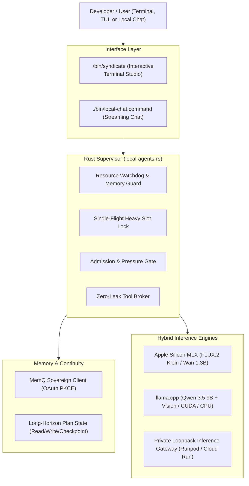

# Contributing to Syndicate

Thank you for contributing to **Syndicate**! Syndicate is an open-source, plug-and-play agent harness built in pure Rust and TypeScript, designed for Apple Silicon, Linux, and hybrid cloud crews.

We welcome bug fixes, documentation improvements, new specialist agent definitions, and model adapters.

---

## 1. Code of Conduct & Core Principles

- **Local-First & Resource-Safe:** Local workloads must strictly honor system memory and disk reserve guards (`LOCAL_AGENTS_MIN_DISK_RESERVE_GIB`). Agents must never exhaust machine resources.
- **Constitutional Stack:**
  - **Rust (`shared/rust-harness/`):** The core process supervisor, resource guards, memory admission controller, and native tool execution engine are authored in Rust.
  - **TypeScript & Node.js (`shared/`, `scripts/`):** TUI runtimes, CLI launchers, and MCP adapters are authored in Node.js (>= 22.18) with TypeScript in strict mode (`strict: true`, `noImplicitAny: true`, `strictNullChecks: true`).
  - **Python ML Kernels:** Isolated strictly to MLX pipelines on Apple Silicon (`shared/harness/media_kernel.py`).
- **Strict Modularity (700 LOC Ceiling):** Keep source files modular and capped at ~600–700 lines of code. Large monoliths must be refactored into cohesive domain submodules.
- **Zero-Leak Security Boundary:** Tool permissions and credentials remain fenced in the harness. Agents and LLMs must never receive raw cloud API keys, provider tokens, or database passwords.
- **Portable Paths:** Never commit absolute paths or hardcoded home directories. Use `$REPO_ROOT`, `$HOME`, or relative resolution.

---

## 2. System Requirements & Quick Setup

### Prerequisites
- **macOS:** Apple Silicon (M1/M2/M3/M4) with macOS 14+; or **Linux / Windows WSL** with CUDA/Vulkan.
- **Rust Toolchain:** `rustc --version` (>= 1.80)
- **Node.js:** `node --version` (>= 22.18)
- **Python:** `python3 --version` (>= 3.11)

### One-Command Setup
Run the automated installation script from the repository root:
```sh
./scripts/install.sh
```

To include the optional pinned local model pack (FLUX.2 Klein, Qwen):
```sh
./scripts/install.sh --with-local-model
```

---

## 3. Architecture Overview



---

## 4. The 5-Gate Verify-With-Evidence Mandate

Every contribution and pull request must satisfy the **5-Gate Verify-With-Evidence Mandate** before being merged:

1. **Gate 1 (Type Soundness & Compilation):**
   - Rust: `cargo check --manifest-path shared/rust-harness/Cargo.toml` passes with 0 errors.
   - TypeScript: `npx tsc --noEmit` passes with 0 errors.
2. **Gate 2 (Test Invariants):**
   - All automated test suites pass with 0 failures:
     ```sh
     # Rust test suite (102 tests)
     cargo test --manifest-path shared/rust-harness/Cargo.toml -- --test-threads=1
     
     # Harness & terminal tests (10 tests)
     node --test shared/harness/*.test.mjs
     
     # Public release verifier regression tests (3 tests)
     node scripts/verify-public-release.test.mjs
     ```
3. **Gate 3 (Build Integrity & Schema Validation):**
   - Production Rust binary compiles cleanly:
     ```sh
     cargo build --release --manifest-path shared/rust-harness/Cargo.toml
     ```
   - JSON schemas match Draft 2020-12 specifications in `schemas/`.
4. **Gate 4 (Visual & Runtime Verification):**
   - Runtime execution verified with real artifacts (e.g., verifying local fallback image generation via `local-agents-rs image` or inspecting generated media).
5. **Gate 5 (Clean Audit & Public Boundary):**
   - Clean, scoped git diff matching the approved tracking issue.
   - Zero hardcoded personal paths, private tenant credentials, or unapproved model identities.

---

## 5. Adding New Agents & Syndicates

### Adding an Agent Role
1. Create a directory under `agents/<role-name>/`.
2. Provide:
   - `PROMPT.md`: Brief role description and standing mission.
   - `SYSTEM_INSTRUCTIONS.md`: Operational boundaries, MemQ verification rules, and tool execution protocol.
   - `config.json`: Execution limits, default tools, and model configuration.
   - `mcp.json`: Enabled MCP servers and tool allowlists.

### Adding a Syndicate Crew
1. Create a manifest under `catalog/syndicates/<syndicate-id>.json`.
2. Validate against [`schemas/syndicate.schema.json`](schemas/syndicate.schema.json).
3. Specify member roles, coordinator, allowed edges, tool ceilings, and maximum round budgets.

---

## 6. Pull Request Process

1. Create a feature branch: `git checkout -b feat/issue-<id>-<slug>`.
2. Implement your changes adhering to strict typing and the 700 LOC file limit.
3. Run the full verification suite (Gates 1–5).
4. Commit with conventional commit messages (e.g. `feat(agent): add support for XYZ capability`).
5. Open a Pull Request referencing the tracking issue (`Resolves #<id>`) including the complete 5-Gate evidence receipt.
6. Pull requests are squash-merged upon review approval.

---

## 7. License

By contributing to Syndicate, you agree that your contributions will be licensed under the [Apache License 2.0](LICENSE).
