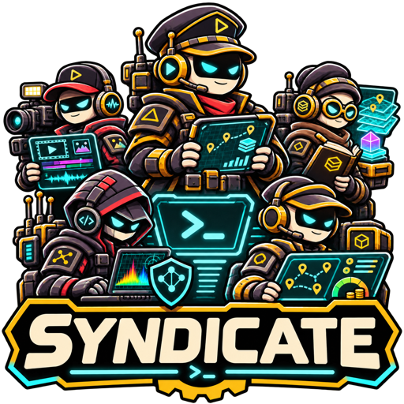

<div align="center">
  
  <h1>Syndicate</h1>
  <p><strong>Governed multi-agent crews in Rust &amp; TypeScript — built for local Apple Silicon, Linux GPUs, and long-span memory continuity.</strong></p>
  <p>
    <a href="LICENSE"></a>
    
    
    
    
    
    
  </p>
</div>

---

**Syndicate** is an open-source, terminal-first harness for running cooperating teams of AI agents ("syndicates") like a disciplined film crew: a coordinator breaks down an objective, delegates bounded slices to specialist agents (coding, research, security auditing, media/documentary production), and a compiled **Rust policy & hardware harness** strictly enforces tool ceilings, host allowlists, GPU/unified-memory pressure limits, and verifiable execution receipts.

---

## Why Syndicate? (Utility & Problems Solved)

Most agent frameworks wrap a single unbounded prompt loop around a model and hope for the best. In real multi-hour engineering and production workflows, that breaks down in four predictable ways — Syndicate is engineered to solve all four:

| Common Agent Failure Mode | How Syndicate Solves It |
| --- | --- |
| **Unbounded tool & network blast radius** | Every crew declares hard capability ceilings in `syndicate.json`; the Rust validator (`shared/rust-harness/src/syndicate.rs`) rejects any member or edge requesting tools or hosts above those ceilings before execution starts. |
| **Context rot & runaway token bills over long projects** | Bounded **MemQ long-span memory slicing** replaces raw transcript stuffing with compact, evidence-linked phase checkpoints and adaptive recall. |
| **Silent OOM crashes & swap thrashing on local GPUs** | Native Rust GPU probes (`shared/gpu-lowmem`) monitor Apple Silicon Metal working-set pressure, Vulkan `VK_EXT_memory_budget`, CUDA VRAM, and disk reserve headroom before admitting model jobs. |
| **"Looks good to me" hallucinations** | A **5-Gate Verify-With-Evidence** workflow requires concrete compiler, test, build, runtime, and diff receipts before marking work complete. |

---

## What Makes Syndicate Unique

1. **Declarative Crew Graphs (`syndicate.json` + `officiation-bundle.json`)**
   - Define an entire multi-agent organization in one auditable JSON graph: entry coordinator, specialist members, directed delegation edges, per-agent turn/timeout budgets, and global security ceilings.
   - Ships with three ready-to-run open-source crews in [`syndicates/`](syndicates/README.md):
     - **`starter-studio`** — 3-agent local software engineering, research, and visual media studio (`studio-lead`, `researcher`, `media-artist`).
     - **`aegis-overwatch`** — 4-agent defensive security and authorized OSINT/SBOM/vulnerability audit team (`aegis-commander`, `osint-sentinel`, `recon-cartographer`, `vuln-auditor`).
     - **`praeco-documentary`** — 6-agent narrated documentary pipeline with three adversarial fact/footage/picture-lock verification loops.
2. **Compiled Rust Supervisor + Native Metal / Vulkan / CUDA Memory Engine**
   - `shared/rust-harness` (`local-agents-rs`) enforces sandbox policy, budget caps, and runtime orchestration.
   - `shared/gpu-lowmem` provides native `objc2-metal` placement-heap aliasing (`MetalTransientArena`) on Apple Silicon, `ash` Vulkan memory-budget telemetry, and zero-panic `libcuda` probing.
   - `shared/gpu-worker` supervises compute kernels with SHA-256 integrity checks and prompt-redacted structured telemetry.
3. **Zero-Leak Credential Boundary**
   - Models and specialist agents never read raw API keys, OAuth tokens, or database credentials. External actions run through scoped harness brokers with fail-closed release verification ([`scripts/verify-public-release.mjs`](scripts/verify-public-release.mjs)).
4. **Provider-Neutral Local-First Portability**
   - Run 100% offline on Apple Silicon Metal or Linux CUDA/Vulkan via `llama.cpp` / MLX, or connect any OpenAI-compatible remote endpoint — with automatic local fallback when offline or rate-limited.

---

## How Syndicate Handles Long-Span Memory

Long-running engineering and research projects fail when agents either **forget yesterday's architectural decisions** or **drown their context window in 100k+ tokens of stale logs**. Syndicate solves long-span memory with a four-layer architecture:

```text
┌────────────────────────────────────────────────────────────────────────────┐
│                   SYNDICATE LONG-SPAN MEMORY ARCHITECTURE                  │
│                                                                            │
│   1. ORIENT (Bounded Recall)                                               │
│      slicer_slice / query_memory pulls ONLY the minimal facts, decisions,  │
│      and failure receipts that change the next action — never full dumps.  │
│                                    │                                       │
│                                    ▼                                       │
│   2. ACT & VERIFY (Isolated Execution)                                     │
│      Crew members run inside a cryptographically bound tenant realm.       │
│      Tags are retrieval labels only — never access controls.               │
│                                    │                                       │
│                                    ▼                                       │
│   3. CHECKPOINT (Phase-Boundary Handoff)                                   │
│      At every milestone or agent handoff, write one compact checkpoint:    │
│      acceptance criteria + artifact hashes + open risks + next action.     │
│                                    │                                       │
│                                    ▼                                       │
│   4. EVIDENCE-LINKED CONSOLIDATION (Read-Only Commons)                     │
│      Repeated text is NOT evidence. Verified outcomes feed reusable        │
│      procedures; cross-team Commons promotion requires human approval.     │
└────────────────────────────────────────────────────────────────────────────┘
```

- **Bounded Adaptive Slicing Instead of Transcript Stuffing:** Rather than replaying entire multi-day histories on every turn, Syndicate loads one compact checkpoint plus targeted slices for named unresolved questions — stopping retrieval as soon as evidence is sufficient.
- **Durable Multi-Agent & Cross-Session Handoffs:** Because checkpoints capture exact file paths, verification receipts, pending side effects, and uncertainty, a fresh session (or a different specialist agent) can resume a 3-day refactor in seconds without re-reading the codebase from scratch.
- **Strict Realm Isolation:** Each project/syndicate binds to its own authenticated memory realm. Private task artifacts stay strictly inside their realm; shared team knowledge lives in a read-only Commons that only accepts explicitly reviewed, evidence-backed promotions.
- **Graceful Offline Degradation:** If no MemQ server is configured or reachable, Syndicate falls back cleanly to local workspace checkpoints (`runs/` & structured artifacts) without blocking local progress.

---

## Getting Started

### Prerequisites

- **OS:** macOS (Apple Silicon M-series recommended, Intel supported), Linux (`x86_64` / `aarch64`), or Windows WSL2
- **Rust:** `cargo` & `rustc` (stable 1.85+) — [rustup.rs](https://rustup.rs)
- **Node.js:** `v22.18+` (for the TypeScript TUI & orchestration scripts)

### 1. Clone & Install

```sh
git clone https://github.com/multinex-ai/syndicates.git
cd syndicates
./scripts/install.sh
```

Want to pre-fetch the default open-source local model pack for 100% offline execution?

```sh
./scripts/install.sh --with-local-model
```

### 2. Build & Verify the Rust Workspace

```sh
cargo check --workspace
cargo test --workspace
cargo build --release
```

### 3. Launch Syndicate

Start the interactive terminal studio:

```sh
./bin/syndicate
```

Or launch a standalone local streaming chat session:

```sh
./shared/bin/local-chat.command
```

### 4. Run or Create Your Own Local Syndicate

Every syndicate follows the same portable folder contract in [`syndicates/`](syndicates/README.md):

```text
syndicates/<your-syndicate>/
├── syndicate.json              # Roster, coordinator, edges, tool & host ceilings
├── officiation-bundle.json     # Optional single-file signed crew bundle
└── agents/
    └── <agent-id>/
        ├── PROMPT.md           # Role brief & mission instructions
        ├── SYSTEM_INSTRUCTIONS.md
        ├── MODEL_PROFILE.txt   # Model profile ID from catalog/models/
        └── config.json         # Per-agent turn & timeout limits
```

To build a private syndicate of your own without mixing it into this open-source repository, create a sibling local workspace with the exact same `syndicates/<name>/syndicate.json` layout and point `SYNDICATE_WORKSPACE=/path/to/your-local-syndicates ./bin/syndicate` at it.

### 5. Configuration & Environment Overrides

Syndicate runs out of the box with sensible local defaults. Customize runtime guards via `.env` or your shell environment:

| Variable | Default | Purpose |
| --- | --- | --- |
| `SYNDICATE_WORKSPACE` | `$PWD` | Active project or local-syndicates directory to operate on. |
| `LOCAL_AGENTS_ALLOW_LOCAL_FALLBACK` | `1` | Automatically falls back to local Apple Silicon / GGUF models if a remote endpoint is unreachable. |
| `LOCAL_AGENTS_MIN_DISK_RESERVE_GIB` | `12.0` | Minimum free disk headroom required before admitting high-memory model jobs. |
| `LOCAL_AGENTS_MEMORY_GUARD` | `1` | Enforces unified memory / VRAM pressure checks before loading model weights. |

---

## Repository Map & Further Reading

- [`syndicates/README.md`](syndicates/README.md) — Built-in open-source crews (`starter-studio`, `aegis-overwatch`, `praeco-documentary`)
- [`agents/README.md`](agents/README.md) — Reusable specialist agent personas
- [`catalog/`](catalog/) — Model capability profiles and syndicate catalog entries
- [`docs/getting-started/README.md`](docs/getting-started/README.md) — Detailed first-run walkthrough
- [`docs/guides/setup-ai-agent.md`](docs/guides/setup-ai-agent.md) — Connecting local models and MemQ long-span memory
- [`docs/public-release-boundary.md`](docs/public-release-boundary.md) — Clean-history public release boundary & fail-closed verifier (`scripts/verify-public-release.mjs`)
- [`CONTRIBUTING.md`](CONTRIBUTING.md) — How to contribute new syndicates, tools, or hardware backends

---

## License

Licensed under the [Apache License 2.0](LICENSE). Third-party model weights, provider endpoints, and external dependencies retain their respective licenses.
