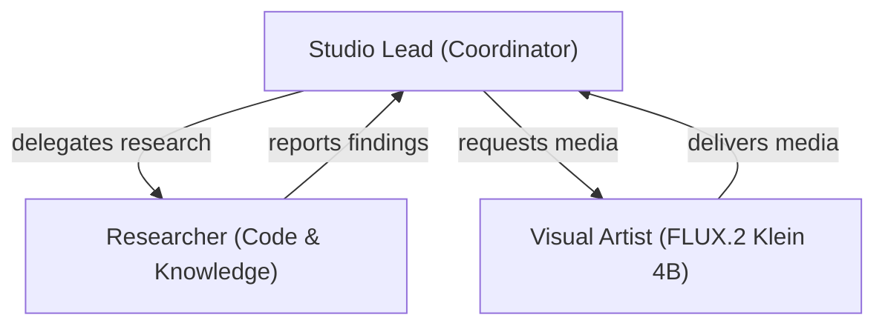

# Local Studio Syndicate (Starter Pack)

This is the default, provider-neutral multi-agent starter syndicate for **Local Syndicate Harness²**.

It operates 100% locally on Apple Silicon (M-series Macs) with zero external cloud dependencies or credentials required.

## Topology



## Agents

1. **Studio Lead & Coordinator (`studio-lead`)**:
   - Model: Qwen 3.5 9B Local (`qwen35-9b-local`)
   - Responsibilities: Analyzes user intent, delegates work to specialists, verifies evidence receipts, and provides concise summaries.
2. **Researcher (`researcher`)**:
   - Model: Qwen 3.5 9B Local (`qwen35-9b-local`)
   - Capabilities: Workspace exploration, syntax verification, local MemQ memory queries and context slicing.
3. **Visual Media Artist (`media-artist`)**:
   - Model: FLUX.2 Klein 4B (`flux2-klein-4b`)
   - Capabilities: On-device diffusion image generation with sub-second prompt dispatch and memory safeguards.

## Running

Launch the syndicate through the local CLI:

```bash
# Launch interactive terminal chat
./shared/bin/local-chat.command

# Or run via local-agents CLI
local-agents run --syndicate starter-studio
```
